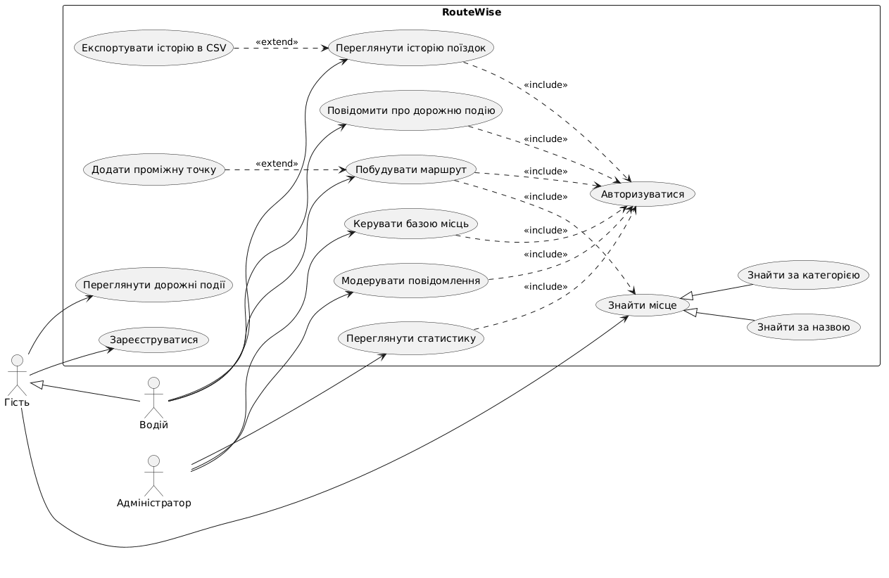

# RouteWise — веб-система GPS-навігації

Веб-застосунок для пошуку місць і побудови маршрутів на карті. Реалізація: PHP / Laravel (MVC), MySQL. Розрахунок маршрутів по дорогах виконує зовнішній сервіс маршрутизації (OpenRouteService API).

## 1. Предметна галузь

Користувач відкриває карту, шукає потрібне місце за назвою чи адресою та будує маршрут від поточного розташування або від іншої точки. Система показує відстань, орієнтовний час у дорозі та покрокові інструкції. Зареєстровані користувачі можуть зберігати улюблені місця, переглядати історію поїздок і повідомляти про затори, ДТП або ремонт дороги. Адміністратор наповнює та підтримує базу місць (POI) і модерує повідомлення про дорожню ситуацію.

### 1.1 Призначення та основні функції

- пошук місць за назвою, адресою або категорією (АЗС, кафе, парковки тощо);
- побудова маршруту між двома точками з можливістю додати проміжні точки;
- вибір режиму пересування: авто, пішки, велосипед;
- розрахунок відстані, часу в дорозі та покрокові інструкції;
- збереження улюблених місць (дім, робота тощо);
- історія поїздок і статистика пробігу;
- повідомлення про дорожні події (затор, ДТП, ремонт) та їх відображення на карті;
- керування базою місць і модерація повідомлень (адміністратор).

### 1.2 Користувачі системи

| Користувач    | Опис                                                                                                       |
| ------------- | ---------------------------------------------------------------------------------------------------------- |
| Гість         | Неавторизований користувач: шукає місця, будує маршрути, бачить дорожні події                              |
| Водій         | Зареєстрований користувач: зберігає місця, має історію поїздок, повідомляє про події. Може все, що й гість |
| Адміністратор | Керує базою місць і категорій, модерує повідомлення про дорожні події                                      |

Зовнішня система: сервіс маршрутизації (OpenRouteService), який повертає геометрію маршруту, відстань і час.

### 1.3 Архітектура

Застосунок побудовано за патерном MVC (Laravel):

- **Model** — Eloquent-моделі (`Place`, `Route`, `Trip`, `TrafficReport` …), кожна відповідає таблиці БД;
- **View** — Blade-шаблони з інтерактивною картою (бібліотека Leaflet + OpenStreetMap);
- **Controller** — обробляють запити: пошук місць, побудова маршруту, збереження поїздок, модерація.

Додатково: сервісний клас для роботи з API маршрутизації, маршрути `routes/web.php` та `routes/api.php`, middleware для ролей, міграції для схеми БД.

### 1.4 Сценарії роботи

1. Гість шукає місце за назвою, система показує його на карті та інформацію про нього.
2. Водій будує маршрут від дому (збереженого місця) до знайденої точки, обирає режим «авто» та отримує відстань, час і покрокові інструкції.
3. Водій повідомляє про затор у поточній точці маршруту, адміністратор підтверджує повідомлення, і воно з'являється на карті для всіх.
4. Водій переглядає історію поїздок і статистику пробігу за місяць.

### 1.5 Логічні сутності та таблиці БД

| Сутність      | Таблиця         | Призначення                                       |
| ------------- | --------------- | ------------------------------------------------- |
| User          | users           | користувачі (водії та адміністратори)             |
| Category      | categories      | категорії місць (АЗС, кафе, парковка …)           |
| Place         | places          | місця на карті (назва, адреса, координати)        |
| FavoritePlace | favorite_places | збережені місця користувача                       |
| Route         | routes          | побудований маршрут (старт, фініш, відстань, час) |
| Waypoint      | waypoints       | точки маршруту (старт, проміжні, фініш)           |
| Trip          | trips           | поїздка водія за маршрутом                        |
| TrafficReport | traffic_reports | повідомлення про дорожні події                    |

### 1.6 Вихідні дані

- маршрут на карті з покроковими інструкціями;
- таблиця історії поїздок (дата, маршрут, відстань, час);
- графік пробігу водія по днях/місяцях;
- карта активних дорожніх подій;
- звіт про найпопулярніші місця та маршрути (для адміністратора).

## 2. Use Cases

### 2.1 Коротка форма — «Знайти місце»

Гість відкриває головну сторінку з картою та вводить у рядок пошуку назву або адресу місця. Система показує список підказок, гість обирає потрібну. Система центрує карту на знайденому місці, ставить маркер і показує картку місця: назву, адресу, категорію, координати та кнопку «Прокласти маршрут сюди».

### 2.2 Поверхнева форма — «Повідомити про дорожню подію»

**Головний сценарій (успішний):**
Водій авторизований і бачить карту зі своїм поточним розташуванням. Він натискає кнопку «Повідомити про подію», обирає тип події (затор, ДТП, ремонт дороги), за потреби додає короткий коментар і підтверджує. Система зберігає повідомлення з координатами та часом і надсилає його на модерацію. Адміністратор переглядає повідомлення і підтверджує його. Подія з'являється на карті для всіх користувачів і автоматично зникає через 2 години, якщо її ніхто не підтвердив повторно.

**Альтернативні сценарії:**

1. Браузер не надав доступ до геолокації — система просить водія вручну вказати точку події на карті.
2. Водій уже надсилав повідомлення про подію в радіусі 200 м за останні 10 хвилин — система повідомляє про дублікат і не створює нове повідомлення.
3. Поряд уже є підтверджена подія такого ж типу — система пропонує водію підтвердити її замість створення нової (лічильник підтверджень збільшується, час життя події подовжується).
4. Адміністратор відхиляє повідомлення як недостовірне — повідомлення не з'являється на карті, водій отримує сповіщення про відхилення.
5. Немає з'єднання з сервером — система показує помилку, і повідомлення не зберігається.

### 2.3 Повна форма — «Побудувати маршрут»

**Use Case Name:** Побудувати маршрут
**Scope:** веб-система GPS-навігації RouteWise (System)
**Level:** User-goal
**Primary Actor:** Водій

**Stakeholders and interests:**

1. Водій — швидко отримати оптимальний маршрут з точним часом у дорозі та зрозумілими інструкціями.
2. Адміністратор — щоб маршрути враховували актуальні дорожні події та база місць була коректною.
3. Сервіс маршрутизації (OpenRouteService) — отримувати коректні запити в межах ліміту API.
4. Власник системи — мінімізувати кількість запитів до платного API (кешування маршрутів).

**Preconditions:** водій авторизований у системі; сервіс маршрутизації доступний.

**Success guarantee:** маршрут відображено на карті, водій бачить відстань, час у дорозі та покрокові інструкції; маршрут збережено в історії водія.

**Main Success Scenario:**

1. Водій відкриває карту та натискає «Маршрут».
2. Система пропонує вказати точку старту та за замовчуванням підставляє поточне розташування водія.
3. Водій вводить точку призначення (через пошук або обирає з улюблених місць).
4. Система знаходить координати обох точок і показує їх маркерами на карті.
5. Водій обирає режим пересування (авто / пішки / велосипед).
6. Водій натискає «Побудувати».
7. Система перевіряє, чи є такий маршрут у кеші; маршруту в кеші немає.
8. Система надсилає запит до сервісу маршрутизації з координатами точок і режимом.
9. Сервіс повертає геометрію маршруту, відстань, час і список інструкцій.
10. Система перевіряє, чи є на маршруті активні дорожні події, і додає до часу затримку.
11. Система зберігає маршрут і точки маршруту в базі даних.
12. Система відображає маршрут на карті, показує відстань, час прибуття та покрокові інструкції.
13. Водій натискає «Почати поїздку», і система створює запис поїздки в історії.

**Extensions:**

- 2a. Браузер не надав доступ до геолокації: система просить водія ввести точку старту вручну.
- 3a. Місце не знайдено: система показує повідомлення «Нічого не знайдено» та пропонує вказати точку кліком на карті.
- 3b. Водій додає проміжну точку:
  1. водій натискає «Додати зупинку» і вводить адресу;
  2. система додає точку до списку і перебудовує порядок точок.
- 5a. Обраний режим неможливий для маршруту (наприклад, пішки між містами понад 100 км): система попереджає та пропонує режим «авто».
- 7a. Маршрут уже є в кеші (будувався менше ніж 15 хвилин тому): система бере його з кешу і переходить до кроку 10.
- 9a. Сервіс маршрутизації не відповідає протягом 10 секунд: система показує помилку і пропонує повторити спробу.
- 9b. Між точками неможливо прокласти маршрут (наприклад, острів без дороги): система повідомляє, що маршрут не знайдено.
- 10a. На маршруті є подія «ДТП» або «ремонт»: система пропонує альтернативний маршрут і показує обидва варіанти для вибору.
- \*a. У будь-який момент водій натискає «Скасувати»: система очищає маршрут з карти.

**Special Requirements:**

1. Час побудови маршруту — не більше 3 секунд у 95 % випадків.
2. Карта та інтерфейс коректно працюють на мобільних пристроях.
3. Кількість запитів до API маршрутизації — не більше 2000 на добу (обмеження безкоштовного тарифу).

**Technology and Data Variations List:**

1. Точку можна задати: поточною геолокацією (Geolocation API браузера), пошуком за адресою або кліком на карті.
2. Карта відображається бібліотекою Leaflet з тайлами OpenStreetMap.
3. Кешування маршрутів реалізується через Laravel Cache (Redis або файловий кеш).

**Frequency of Occurrence:** близько 60 % усіх дій у системі.

**Miscellaneous (Open Issues):**

1. Чи потрібна навігація в реальному часі з автоматичною перебудовою маршруту при відхиленні?
2. Чи потрібна підтримка офлайн-карт?
3. Чи враховувати платні дороги та пороми під час побудови маршруту?

## 3. Діаграма варіантів використання

Вихідний код: [use-case-diagram.puml](use-case-diagram.puml)
